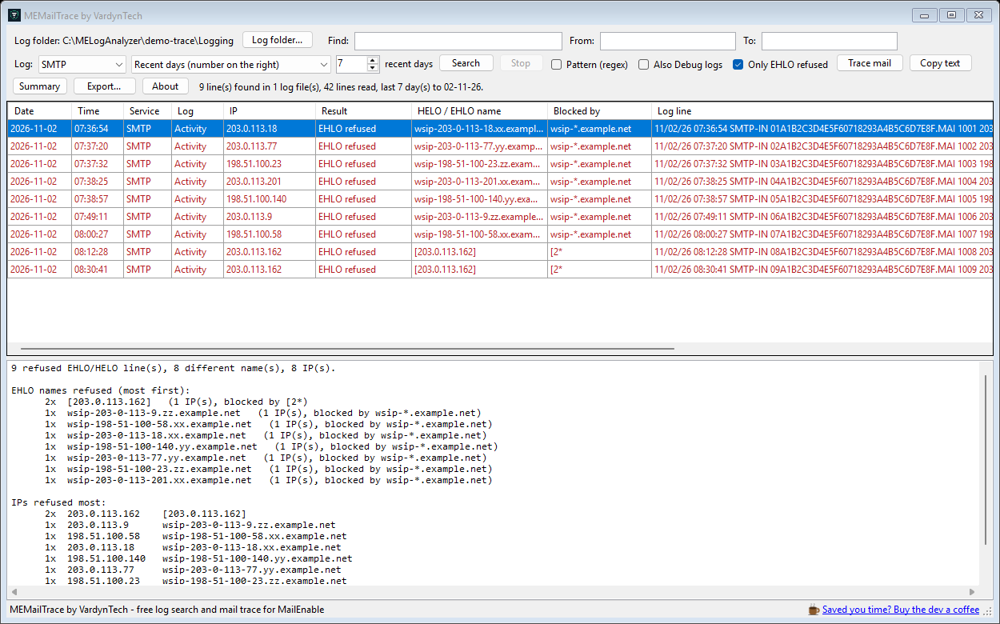
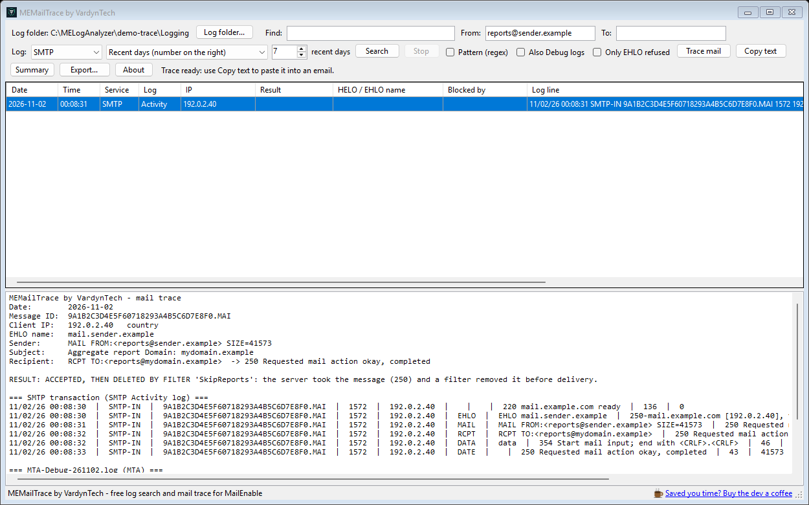
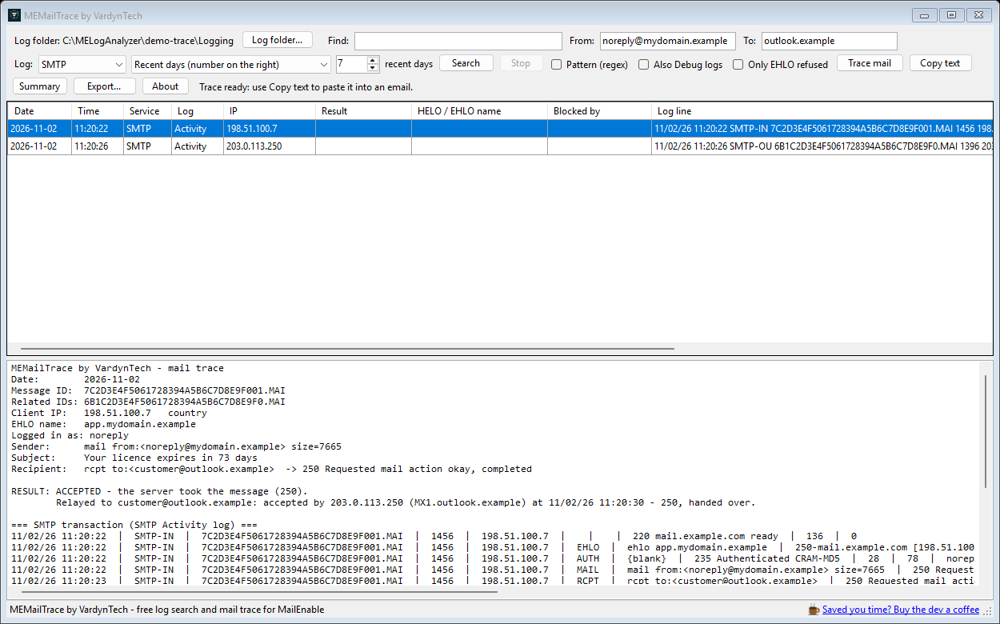
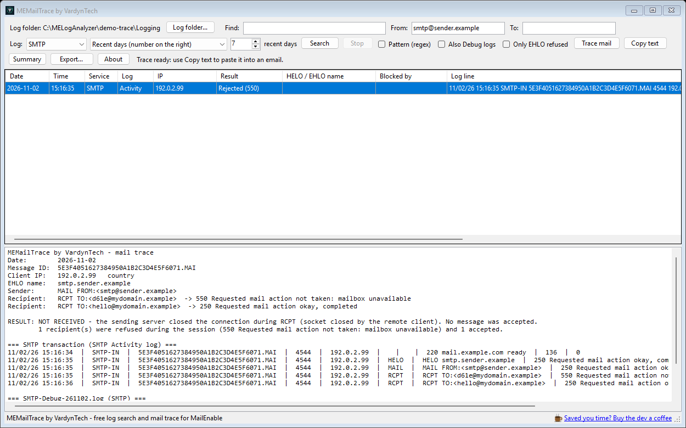

# MEMailTrace by VardynTech

**Find what MailEnable's own Message Route Trace cannot show - and get the whole story of one mail in a single text you can paste to your client.**

MEMailTrace searches the raw MailEnable SMTP, POP and IMAP logs, including the connections that never became a message: refused at EHLO/HELO, failed logins, quits without sending anything. For a mail that did arrive it builds one combined trace - the SMTP transaction, the MTA and filter log lines, and a plain result: refused, accepted, deleted by a filter, relayed.

Free for everyone running MailEnable. No licence key, no install, no cloud account, no telemetry. It only reads your logs.

[Download the latest release](https://github.com/VardynTech/MEMailTrace/releases/latest) · [Buy the dev a coffee](https://buymeacoffee.com/vardyntech) · [vardyntech.com](https://vardyntech.com)

---

## The problem it solves

MailEnable's **Message Route Trace Utility** starts from a sender or recipient and lists only mail that was *accepted* into the queue. A connection refused by the *EHLO strings to block* list never gets that far, so it never appears. You see "No matching messages" and cannot tell "it never connected" from "it was blocked". Support questions like "why did my mail not arrive?" turn into reading raw logs.

MEMailTrace reads those raw logs for you.

## What it does

- **Finds anything in the logs.** Search any text (an IP, HELO name, sender, recipient, account, domain) in the SMTP, POP and IMAP Activity logs, optionally the Debug logs too. Search the recent days, every day that has a log file, or one day picked from the log days that really exist on the server.
- **Shows what happened to each connection.** The **Result** column labels each row: *EHLO refused*, *Login failed (535)*, *Rejected (550)*, *Temp refused (4xx)*.
- **Tells you which EHLO was refused, and by what.** Tick **Only EHLO refused** to list every connection MailEnable refused at EHLO/HELO. Each row shows the EHLO name the sender used and the entry of your *EHLO strings to block* list that caught it (read from the registry, read only). **Summary** groups the refused names and the busiest IPs.
- **Finds one message precisely.** Fill in **From**, **To** and **Find** together: the search returns whole messages, one row each, where every box you filled matches.
- **Traces one mail.** Select a row and click **Trace mail** (or double-click). One report with the Message ID, IP, EHLO name, the account it logged in as, sender, subject, recipients, the SMTP transaction, the MTA, filter and debug log lines of that Message ID, the outbound copies MailEnable made of it, and a **RESULT** line on top. **Copy text** puts it on the clipboard.
- **Sorts.** Date and time columns; click any header to sort.
- **Exports** the results to CSV or text.

## The RESULT line

| Result | When |
|---|---|
| REFUSED - EHLO block | the connection was refused at EHLO/HELO (550 Policy violation); shows the EHLO name and the block-list entry that matched |
| REFUSED - login failed | 535 Invalid Username or Password |
| ACCEPTED, THEN DELETED BY FILTER | the server said 250, then the MTA log shows a filter deleting the message (the filter's name is shown) |
| ACCEPTED | the server said 250; the trace states which mailbox and folder it was delivered to, where it was forwarded, and which remote server accepted each relayed copy |
| NOT RECEIVED | the sending server closed the connection before the message was complete |
| REJECTED | every recipient was refused |
| CONNECTED but no mail was sent | the client connected and left (or only probed) |
| INCOMPLETE | a sender was given but the server never confirmed a message |

For mail relayed outbound, the trace follows the outbound copies MailEnable makes and shows which remote server accepted each one and when.

## Quick start

1. Download the zip from the [Releases page](https://github.com/VardynTech/MEMailTrace/releases/latest) and unzip it anywhere on the mail server (or on a PC that can read the log folder).
2. Run `MEMailTrace-by-VardynTech.exe`. It looks for the MailEnable `Logging` folder in the default install locations; if it cannot find it, choose the folder that contains `SMTP`, `POP` and `IMAP`. It remembers your choice.
3. Type something in **Find**, or fill in **From** and **To**, and press Enter. For refused connections tick **Only EHLO refused**.
4. Select a row and click **Trace mail**. Wait for the report, then **Copy text** and paste it into your reply.

## Good to know

- **Read only.** It never changes MailEnable, its settings or its logs.
- **A mail dropped by Windows Firewall** (a blocked IP) never reaches MailEnable, so it leaves no log line and cannot be shown.
- **The RESULT line is a reading of the log lines**, not a promise about the mailbox. It reports what MailEnable logged. If the logs of that day have been rotated away, the report says what it could not find. Log wording can differ between MailEnable versions; please report anything it gets wrong.
- Message-level search (From / To) covers SMTP. **Only EHLO refused** cannot be combined with From / To, because a refused connection never got as far as a sender.
- The *Blocked by* column needs MailEnable's block list in the registry of the PC you run it on. If you run MEMailTrace on another PC, the column stays empty; everything else works.

## Requirements

- Windows Server 2008 R2 / Windows 7 or later, with .NET Framework 4.0 or later.
- Read access to the MailEnable `Logging` folder.
- Administrator rights are not needed, unless the log folder itself requires them.

## Privacy

- Everything runs locally. Logs are read on your machine and never uploaded.
- No telemetry, no phone-home, no internet access at all. The website and coffee links open your browser only when you click them.
- The country shown next to an IP comes from a table built into the program.

## Support

Questions, bugs, ideas: open an [issue](https://github.com/VardynTech/MEMailTrace/issues). Please attach the exact message and, if you can, a screenshot with addresses and account names hidden.

If MEMailTrace saved you time, [buy the dev a coffee](https://buymeacoffee.com/vardyntech).

Also from VardynTech: [MELogAnalyzer Shield](https://github.com/VardynTech/MELogAnalyzer-Shield) - stops brute-force attacks on MailEnable by blocking IPs and ranges in Windows Firewall.

## Licence and trademarks

Free to use, including on commercial servers. See [LICENSE.txt](LICENSE.txt). The program is provided as is, without warranty.

MailEnable and Windows are trademarks or copyrights of their respective companies. This program is independent and is not made or endorsed by them.

(c) 2026 VardynTech. All rights reserved.
